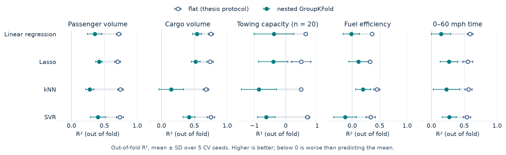
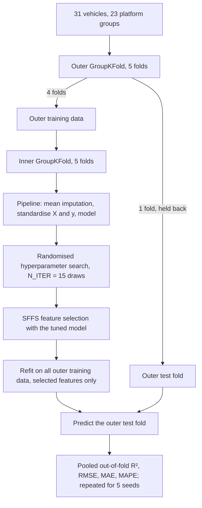

# Small-data model selection for early-stage vehicle design

Which regression model can you trust with about 30 data points, and how much does the evaluation protocol change the answer?

[](https://www.python.org/)
[](https://scikit-learn.org/)
[](LICENSE)
[](https://kivanho.github.io)

<picture>
  <source media="(prefers-color-scheme: dark)" srcset="docs/r2_by_protocol_dark.png">
  
</picture>

## What it is

A cleaned-up, public version of the code from my bachelor's thesis (TU Berlin, 2024). It
predicts five functional attributes of midsize sedans from nine design variables with four
model families (linear regression, Lasso, k-nearest neighbours, support vector regression) and
compares the thesis evaluation protocol with repeated nested cross-validation that keeps
badge-engineered twins in the same fold.

| Functional attributes (targets) | Design variables (features) |
|---|---|
| passenger volume, cargo volume, towing capacity, fuel efficiency, 0–60 mph acceleration | fuel tank capacity, engine displacement, front track width, wheelbase, ground clearance, height, length, tyre width, tyre diameter |

## Data

[`data/midsize_sedans.csv`](data/midsize_sedans.csv) holds 31 midsize sedans sold in the USA in
2002. The values were compiled for the thesis from the published vehicle table in de Weck (2006)
(see Citation); that chapter is a Springer publication and not open access. Compared with the
thesis spreadsheet, the column names and four vehicle-name typos were changed, the towing
placeholders below were removed, and the `platform_group` column was added.

* **Towing capacity: n = 20.** In the thesis spreadsheet 11 vehicles had a towing capacity of
  exactly 1,225 lb, which is the mean of the other 20 values, i.e. imputed placeholders. They are
  stored as missing, and rows with a missing target are dropped for that target only.
* **Ground clearance** is missing for 5 vehicles and is mean-imputed inside the pipeline,
  fitted on training folds only.
* **Platform twins.** Seven groups of vehicles are the same car under different brands or have
  identical chassis dimensions: Chevrolet Impala / Monte Carlo, Buick Century / Regal,
  Pontiac Grand Am / Oldsmobile Alero, Dodge Intrepid / Chrysler Concorde, Ford Taurus /
  Mercury Sable, Hyundai Sonata / Kia Optima, and Chrysler Sebring / Dodge Stratus /
  Mitsubishi Galant. `platform_group` records them (other vehicles are their own group), giving
  23 groups for 31 vehicles. Wider platform families such as all GM W-body cars are not grouped.
* **Front track width vs weight.** The thesis text and defence slides list *weight* as design
  variable x3, but the thesis spreadsheet and code used *front track width* as x3, and the
  reported thesis numbers come from that. This repository follows the code. Curb weight and
  horsepower are in the CSV for reference only; in de Weck's model they are intermediate
  variables, not design variables.
* `tire_diameter_in` is the wheel (rim) diameter, 15 or 16 inches.

To use another dataset, provide a CSV with the 14 feature and target columns below. An
optional `vehicle_id` column becomes the index, an optional `platform_group` column defines CV
groups, extra columns are ignored, and missing values are allowed.

```
fuel_tank_capacity_gal, engine_displacement_cc, front_track_width_in, wheelbase_in,
ground_clearance_in, height_in, length_in, tire_width_mm, tire_diameter_in,
passenger_volume_cuft, cargo_volume_cuft, towing_capacity_lb, fuel_efficiency_mpg,
acceleration_0_60_s
```

If your headers differ, pass `column_map={"your_name": "expected_name"}` to `load_dataset`.

## Method



* **Main protocol: repeated nested `GroupKFold`.** The outer loop only scores. Imputation,
  scaling, hyperparameter search and sequential floating forward selection (SFFS) see only the
  outer training data, and both loops keep a platform group in a single fold.
* **Target scaling.** Every model is wrapped in `TransformedTargetRegressor(StandardScaler())`,
  so Lasso `alpha` and SVR `C` / `epsilon` mean the same for every target.
* **Search space.** Log-uniform priors for Lasso `alpha` (1e-3 to 1), SVR `C` (1e-2 to 1e2),
  `epsilon` (1e-3 to 1) and `gamma` (1e-3 to 1); `gamma` is sampled only for the rbf, sigmoid
  and poly kernels. kNN draws k from 1 to 8 and uniform or distance weights. One constant,
  `N_ITER = 15`, sets the number of search draws in every protocol.
* **Repetition.** Everything runs for seeds 0–4. Tables report mean ± SD over seeds. The SD
  covers only the random assignment of vehicles to folds, not the full sampling uncertainty of
  a 31-car dataset.
* **Comparison protocols.** `flat_cv` is a re-implementation of the thesis protocol: tune and
  select features with random 5-fold CV on all rows, then score on the same folds. Nested CV with
  random `KFold` is also run, to separate the effect of fold reuse from the effect of twins.

## Results

Out-of-fold R², flat thesis re-implementation → **nested GroupKFold** ± SD over 5 seeds
(source: [`results/cv_results.csv`](results/cv_results.csv)).

| Target (n) | Linear regression | Lasso | kNN | SVR |
|---|---|---|---|---|
| Passenger volume (31) | 0.72 → **0.35** ± 0.11 | 0.70 → **0.42** ± 0.05 | 0.74 → **0.28** ± 0.06 | 0.73 → **0.40** ± 0.12 |
| Cargo volume (31) | 0.75 → **0.54** ± 0.07 | 0.74 → **0.52** ± 0.07 | 0.68 → **0.15** ± 0.19 | 0.75 → **0.42** ± 0.09 |
| Towing capacity (20) | 0.63 → **−0.38** ± 0.63 | 0.49 → **−0.40** ± 0.46 | 0.49 → **−0.86** ± 0.56 | 0.69 → **−0.62** ± 0.28 |
| Fuel efficiency (31) | 0.36 → **−0.02** ± 0.15 | 0.32 → **0.11** ± 0.18 | 0.45 → **0.20** ± 0.14 | 0.33 → **−0.13** ± 0.21 |
| 0–60 mph time (31) | 0.59 → **0.15** ± 0.15 | 0.55 → **0.27** ± 0.13 | 0.56 → **0.23** ± 0.20 | 0.54 → **0.27** ± 0.11 |

Median over the five targets. The last two columns are differences of the medians shown.

| Model | Flat (thesis re-impl.) | Nested, random KFold | Nested, GroupKFold | Flat − nested KFold | Nested KFold − GroupKFold |
|---|---|---|---|---|---|
| Linear regression | 0.63 | 0.32 | 0.15 | 0.31 | 0.17 |
| Lasso | 0.55 | 0.36 | 0.27 | 0.19 | 0.09 |
| kNN | 0.56 | 0.26 | 0.20 | 0.30 | 0.06 |
| SVR | 0.69 | 0.23 | 0.27 | 0.46 | −0.04 |

* Reusing the scoring folds for tuning and feature selection inflates R² for every model on
  every target. Keeping twins out of each other's test folds lowers the scores further for
  linear regression, Lasso and kNN.
* Cargo volume (R² ≈ 0.5) and passenger volume (up to ≈ 0.4) are partly predictable from the
  design variables; acceleration and fuel efficiency are weak (R² ≤ 0.27). Towing capacity is not
  predictable at n = 20: every model scores below zero, although the flat protocol reports 0.5–0.7.
* No model family wins clearly. For each target the best and second-best model differ by
  0.01–0.08 R², less than the seed-to-seed SD of the best model. Lasso is within 0.09 of the
  best model on every target.
* The most stable SFFS choices are physically plausible: length, fuel-tank capacity and height
  for cargo volume, engine displacement for fuel efficiency and acceleration.

### Relation to the thesis numbers

`flat_cv` re-implements the thesis protocol; it does not reproduce the thesis defence values.
For reference, the defence reported these CV R² values (mean over 5 folds, single seed):

| Target | Linear regression | Lasso | kNN | SVR |
|---|---|---|---|---|
| Passenger volume | 0.58 | 0.59 | 0.75 | 0.78 |
| Cargo volume | 0.71 | 0.66 | 0.65 | 0.67 |
| Towing capacity | −2.91 | −2.83 | 0.24 | −0.18 |
| Fuel efficiency | 0.22 | 0.16 | 0.42 | 0.15 |
| 0–60 mph time | 0.42 | 0.35 | 0.31 | 0.38 |

The numbers differ for concrete reasons:

* **Rows.** The thesis held out the Honda Accord as a separate evaluation car, so CV ran on 30
  vehicles, and it used the 1,225 lb towing placeholders as real values. Here all 31 vehicles are
  in CV and towing has n = 20. No evaluation car is held out; nested CV plays that role.
* **Metric.** The thesis averaged R² over five test folds of about 6 cars each. The main metric
  here is R² on the pooled out-of-fold predictions; the notebook also reports the per-fold mean,
  which is lower and noisier.
* **Search.** The thesis drew 50 settings from uniform ranges on the raw target. Every protocol
  here draws 15 settings from log-uniform ranges on the standardised target.
* **Preprocessing.** The thesis mean-imputed ground clearance on the full dataset before
  splitting. Here imputation is fitted inside the pipeline.
* **Seed.** The thesis used one seed (42); here the results are averaged over five.

The thesis also built a de Weck-style response-surface regression with interaction terms. It is
not part of this repository.

## Quick start

Tested with Python 3.12 and the pinned versions in `requirements.txt`.

```bash
python3.12 -m venv .venv && source .venv/bin/activate
pip install -r requirements.txt
jupyter lab notebooks/
```

Re-run the analysis and redraw the figure from the command line:

```bash
jupyter nbconvert --to notebook --execute --inplace notebooks/02_model_selection.ipynb
python scripts/make_figures.py
```

`02_model_selection.ipynb` took about 15 minutes on an 8-core Apple M1 laptop that was also
running other jobs. Nearly all of it is SFFS inside the 300 nested runs. To run on another file:

```bash
DATA_PATH=/path/to/your.csv jupyter nbconvert --to notebook --execute notebooks/02_model_selection.ipynb --output-dir /tmp
```

## Repository layout

| Path | Content |
|---|---|
| [`data/midsize_sedans.csv`](data/midsize_sedans.csv) | 31 vehicles, 9 design variables, 5 functional attributes, platform groups |
| [`src/smalldata/data.py`](src/smalldata/data.py) | CSV loader and schema check |
| [`src/smalldata/modeling.py`](src/smalldata/modeling.py) | model candidates, `nested_cv`, `flat_cv`, `run_repeated`, result tables |
| [`notebooks/01_explore_data.ipynb`](notebooks/01_explore_data.ipynb) | summary statistics, platform twins, correlations, single-variable baselines, outliers |
| [`notebooks/02_model_selection.ipynb`](notebooks/02_model_selection.ipynb) | nested GroupKFold CV, predicted vs actual, feature-selection stability, protocol comparison |
| [`results/cv_results.csv`](results/cv_results.csv) | per-run scores of all three protocols (300 rows) |
| [`scripts/make_figures.py`](scripts/make_figures.py) | draws the figures in `docs/` from the results file |

## Limitations

* 31 vehicles (20 for towing) from one market segment and one year. The results describe this
  dataset, not vehicle design in general.
* Seed-to-seed SD understates the real uncertainty; with 23 groups, a few unusual vehicles can
  move R² by 0.1 or more.
* The twin groups are defined by hand from badge engineering and identical chassis dimensions.
  Grouping whole platform families would be stricter and would likely lower the scores further.
* Towing capacity takes only four distinct values here (1,000 to 2,000 lb) and is better treated
  as a rating than a continuous quantity.
* The search budget (15 draws) is small, chosen to keep the runtime reasonable. SFFS on about 25
  training rows is itself a source of variance.

## Citation and context

* de Weck, O. L. (2006). Determining product platform extent. In T. W. Simpson,
  Z. Siddique & J. R. Jiao (Eds.), *Product Platform and Product Family Design:
  Methods and Applications* (pp. 241–301). Springer.
  https://doi.org/10.1007/0-387-29197-0_12 (source of the vehicle data)
* Rahn, M., Göhlich, D., Fay, T.-A., & van Ho, K. (2025). Data-driven design: predicting
  functional attributes in early-stage automotive engineering. *Proceedings of the Design
  Society*, 5, 1091–1099. https://doi.org/10.1017/pds.2025.10123 (follow-up paper on the same
  dataset; it held out the Mercury Sable as its evaluation car)
* Bachelor's thesis: Kien van Ho, TU Berlin, 2024.

## License

MIT, see [LICENSE](LICENSE).
